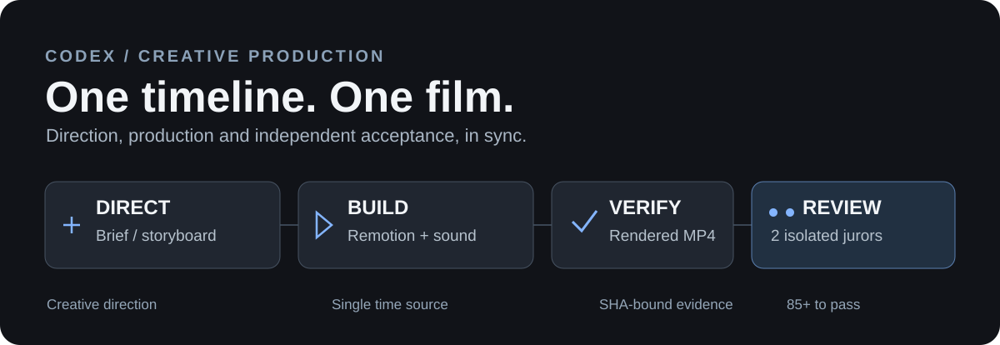

# Unified Motion Director

**Codex 產品敘事與精密動態影像 Skill。** 由產品功能理解、主張證據查核、分鏡時間線、Remotion 動畫製作，到實際影片嘅雙獨立 Agent 驗收，統一成一套可以追溯嘅工作流程。

<p align="center"></p>

[English](README.md) · [Skill 指示](SKILL.md) · [更新紀錄](CHANGELOG.md) · [來源授權](ATTRIBUTION.md)

## v1.9：Mografy 本地 Canvas 動畫路線

新增 [Mografy](https://github.com/zz41354899/mografy) 作為**可選、獨立安裝**嘅 Canvas 2D 製作後端，適合文字、數字、圖形動態效果同繁體中文／日文排版。**Remotion Plugin 繼續優先處理 React 產品 UI 影片**，原有 Product Truth Gate、影片 SHA-256 綁定同雙獨立 Agent 驗收唔變。

```bash
python3 scripts/production_router.py film/storyboard.json --engine mografy --out film/route
python3 scripts/mografy_bridge.py prepare film/storyboard.json --out film/mografy-handoff

# 另外喺已安裝、經授權嘅 Mografy 專案執行：
mografy check projects/<film>
mografy review projects/<film>
mografy export projects/<film> --format mp4

# 使用實際產生嘅影片：
python3 scripts/mografy_bridge.py verify --handoff film/mografy-handoff/mografy-handoff.json --video projects/<film>/renders/final.mp4 --out film/verified-media.json
```

交接工具只生成計劃、時間線同檔案校驗碼，**唔會自行安裝 Mografy 或輸出影片**。`verify` 只確認編碼影片嘅時間、幀率、畫面比例同 SHA，唔代表真實審美評分或已核實 Mografy 出片來源。詳見 [Mografy 整合指引](references/mografy-canvas-production.md)。

## v1.8：鏡頭連續性 × 聲畫編排

新增對 **OneTake** 高連續性鏡頭、運鏡預判與停頓，以及 **huashu-motion** 先定音樂節奏、再讓主要視覺動作落點對應聲音嘅原則性研究。只加入 **獨立編寫** 嘅規範、Storyboard 欄位同規劃檢查工具，**不包含任何上游程式碼、音樂樣本、動畫引擎或素材**。OneTake 上游為 PolyForm Noncommercial，UMD 繼續為 MIT。

```bash
python3 scripts/validate_storyboard.py path/to/storyboard.json
python3 scripts/motion_spine.py path/to/storyboard.json --out motion-spine.json
```

以上只作 **規劃階段** 連續性及聲畫時間差檢查，並非完成影片嘅實際同步或審美評分。Remotion Plugin、產品主張驗證及雙獨立評審保持不變。

## v1.7 有咩提升

- **產品敘事理解**：由功能因果關係推導畫面，而唔係盲目加入特效。
- **產品真實性 Hard Gate**：產品主張必須提供證據，實驗／示意功能必須保留揭示。
- **音樂分析**：根據實際音訊提出節拍及 Drop 候選，不冒稱已人工核實。
- **語義動態文字**：繁體中文以詞組／短句分段，重點數字與文字保留閱讀時間。
- **Motion Grammar**：把 UI、數據、路徑、數字同品牌串成有資訊意義嘅轉場。
- **手機可讀性檢查**：從真實版面幾何資料檢查字級、邊界同停留時長；審美仍由獨立評審決定。

保留原有審美 **55%**、整體 **45%**，總分 ≥85、兩名評審各 ≥80 嘅驗收要求。真實性屬**獨立阻擋條件**，唔可以用高審美分數抵消。

## 安裝

```bash
python3 scripts/install_codex.py --user --apply
# 或安裝到專案
python3 scripts/install_codex.py --project /path/to/project --apply
```

Skill 不會自動安裝 [Remotion Plugin](https://chatgpt.com/plugins/remotion)。可使用已連接嘅 Plugin、官方 Remotion CLI，或其他已支援嘅動畫後端。

## 執行流程

**產品證據 → 真實性檢查 → 創意導演 → 分鏡與時間線 → Remotion／動畫引擎 → MP4 → 技術及可讀性檢查 → 雙獨立評審 → 驗收**

```bash
python3 scripts/validate_storyboard.py /path/to/film/storyboard.json
python3 scripts/product_truth.py /path/to/film/claims.json --storyboard /path/to/film/storyboard.json
python3 scripts/analyze_music.py /path/to/audio.wav --out /path/to/film/beat-analysis.json
python3 scripts/production_router.py /path/to/film/storyboard.json --out /path/to/film/handoff
python3 scripts/remotion_plugin_bridge.py prepare /path/to/film/storyboard.json --out /path/to/film/remotion-handoff
python3 scripts/motion_preflight.py /path/to/film/final.mp4 --layout-manifest /path/to/film/layout.json --out /path/to/film/preflight.json
```

音樂節拍偵測係候選結果；字體幾何檢查係預警。佢哋都唔會自動宣稱已聽完整首歌曲或已評審影片視覺品質。程式測試使用中立技術 fixture，Repo 唔包含任何特定品牌宣傳案例。

深入規格見 [產品敘事](references/product-storytelling.md)、[動態文字](references/kinetic-typography.md)、[動效語法](references/product-motion-patterns.md)、[視覺 Presets](references/visual-presets.md)、[驗收](references/independent-acceptance.md)。

## 測試及授權

```bash
python3 -m unittest discover -s tests -v
```

原始編排程式及文件以 [MIT](LICENSE) 授權；引用技法及第三方媒體另外遵守原作者授權，詳見 [ATTRIBUTION.md](ATTRIBUTION.md)。通過自動測試唔代表已實際製作 MP4、調用 Remotion Plugin 或完成獨立 AI 審美評審。
